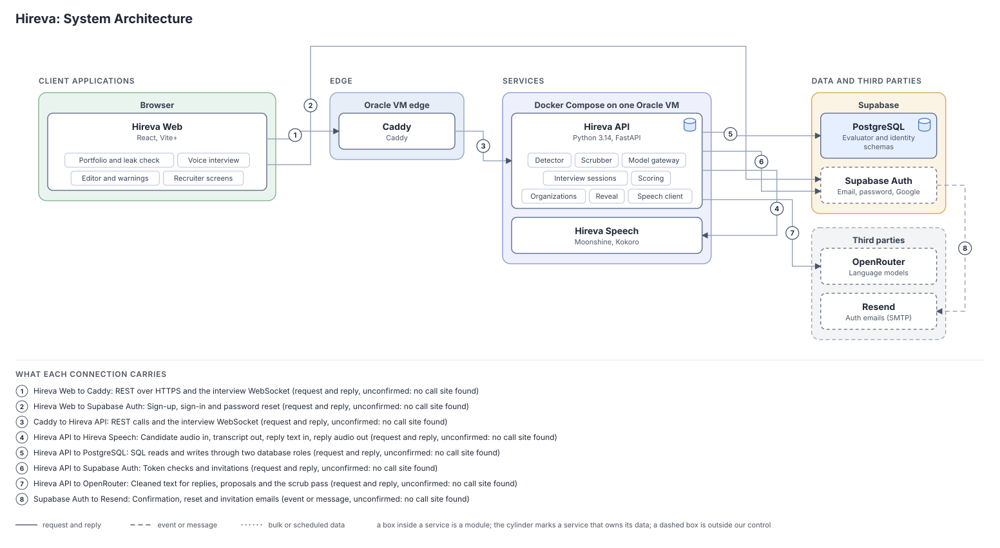
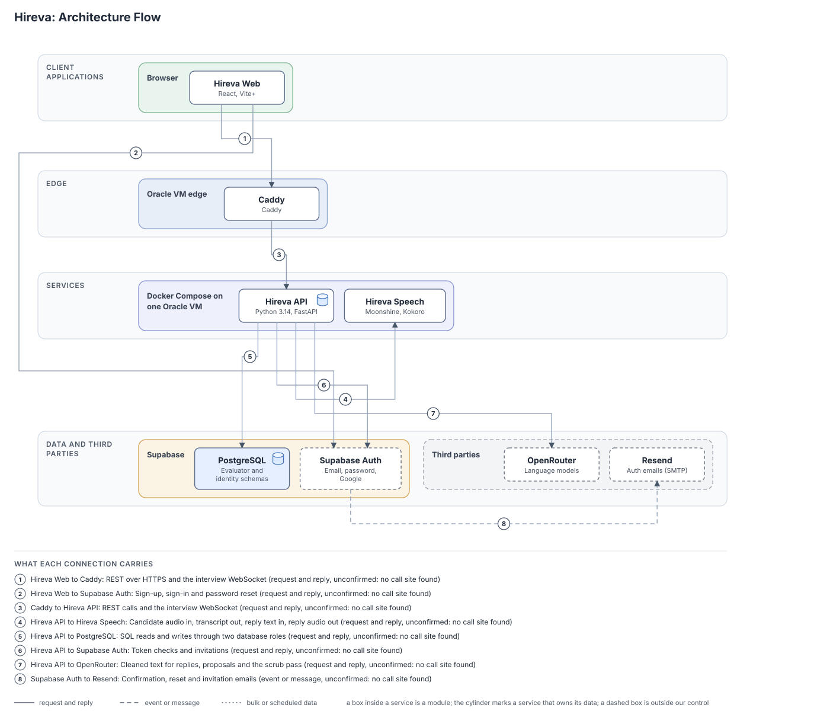
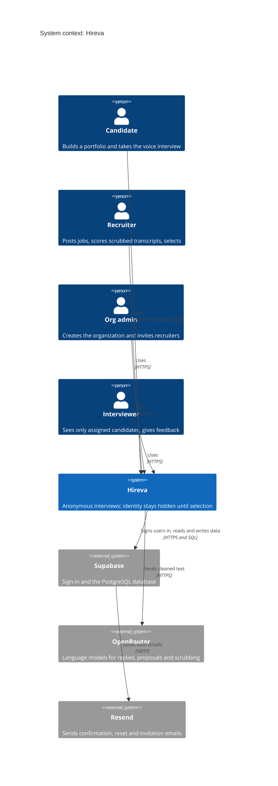
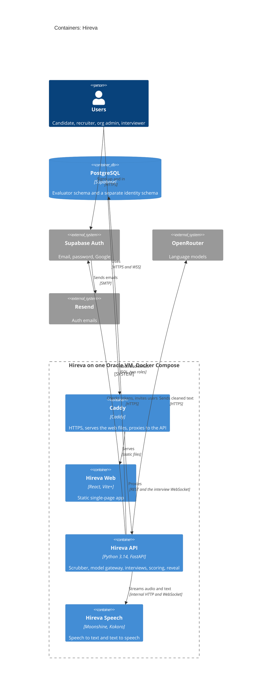
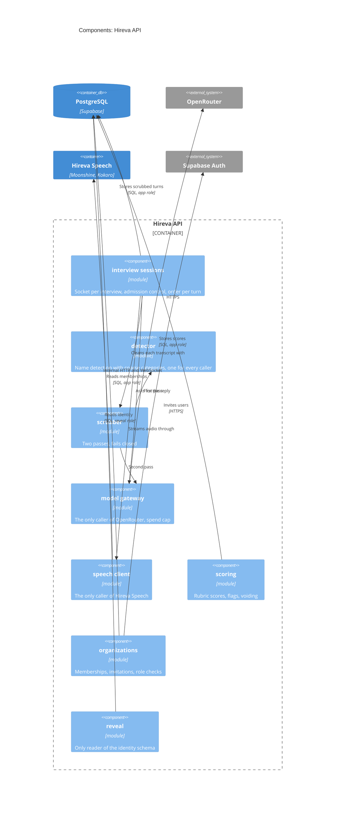
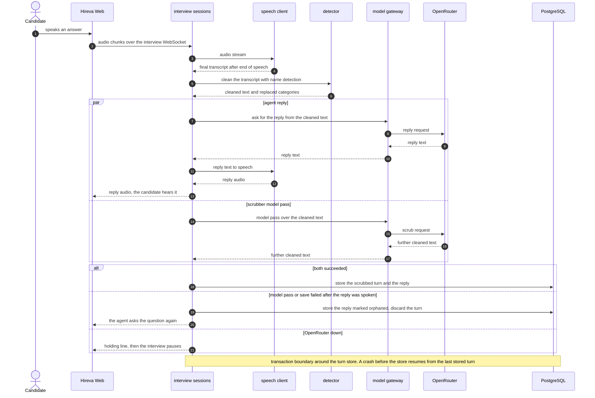

# Architecture: Hireva

- Task: none
- Serves: REQ-003, REQ-018, REQ-024, REQ-025, REQ-026, REQ-031, REQ-032, REQ-037, REQ-039, REQ-041, REQ-045; US-00-004, US-00-005, US-01-007; ADR-0001 to ADR-0011
- Generated on 2026-10-21 by architecture-diagram, version 1
- Sources: the approved HLD (docs/design/hireva-hld.md) and the ADRs. There is no code, no compose file and no manifest yet, so every element and edge below is a design claim, not something found in code, and every edge is on the unconfirmed list.

Drawn images, from docs/architecture/architecture.json:
- 
- 

## 1. Context

Four user roles come from the PRD (REQ-044): candidate, recruiter, org admin and interviewer. External systems come from the ADRs.

## 2. Containers

Production view. There is no dev-only service yet.

## 3. Components: Hireva API

The container with the most modules. These packages are planned in the HLD and the tenets, not read from imports.

Skipped: none (nothing under 30 lines, because nothing is written).

## 4. Sequences

### One interview turn (the interview WebSocket, US-00-004, US-00-005)

No code exists, so this follows the HLD flow B and the order per turn in HLD section 7, not a traced path. Participants are the HLD's modules.

External side effect before the commit: the agent's reply is spoken before the turn is stored. The failure branch above says what is left: the candidate heard a reply, no candidate turn is stored, and the reply is kept marked orphaned.

## Legend

- Mermaid shapes are only those in the template: Person, System, System_Ext, Container, ContainerDb, Component, Rel.
- In the drawn SVG, a solid line is a request and reply, a dashed line is an event or message, a dashed box is outside our control, a cylinder marks the service that owns data.
- Skipped: the DeploymentArchitecture view (no deployment model yet), and the component views of Hireva Web and Hireva Speech (nothing to show before code).

## Sources

| Element | Source |
| --- | --- |
| Hireva Web, Hireva API, Hireva Speech, Caddy | docs/design/hireva-hld.md, section "What gets built" and section 3 |
| PostgreSQL, Supabase Auth | docs/adr/0001, docs/adr/0006 |
| OpenRouter | docs/adr/0003 |
| Resend | docs/adr/0011 |
| Hireva Speech models | docs/adr/0009 |
| Interview WebSocket | docs/adr/0010 |
| REST with OpenAPI | docs/adr/0008 |
| Caddy and Compose on one VM | docs/adr/0004, docs/adr/0005 |
| Detector, scrubber, model gateway, speech client, reveal | docs/architecture/tenets.md, docs/design/hireva-hld.md section 3 |
| Roles | docs/product/PRD.md, REQ-044 |

## Unconfirmed

All eight drawn edges and every element are inferred from the HLD and ADRs, because there is no code, no compose file and no client call to confirm them.
- Hireva Web to Caddy: inferred from ADR-0005 and HLD section 3.
- Hireva Web to Supabase Auth: inferred from HLD section 3 (the browser signs in through Supabase).
- Caddy to Hireva API: inferred from ADR-0005 and ADR-0010.
- Hireva API to Hireva Speech: inferred from ADR-0009.
- Hireva API to PostgreSQL: inferred from ADR-0001 and Q-023.
- Hireva API to Supabase Auth: inferred from ADR-0006 and US-01-010.
- Hireva API to OpenRouter: inferred from ADR-0003.
- Supabase Auth to Resend: inferred from ADR-0011.
- The module names in the component view: inferred from the HLD and tenets.

## Noticed

- The HLD says the diagram was "not drawn yet"; it is drawn now, so that line needs updating (done in the HLD).
- docs/architecture/repo-plan.json lists four repositories, but the diagram shows five boxes in the system (Caddy and Hireva Web are in two repositories, HirevaInfra and HirevaClient); nothing disagrees.
