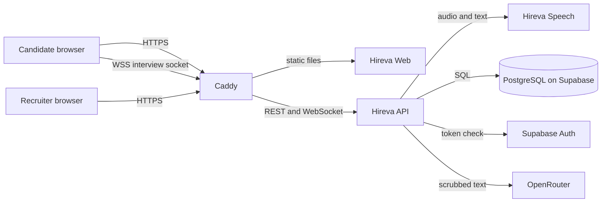

# High Level Design: Hireva anonymous interview platform

- Task: none
- Author, date: unattributed (no .bearing/company.json), 2026-10-21
- Status: Approved
- PRD: docs/product/PRD.md
- ADRs: docs/architecture/decisions.md
- Tenets: docs/architecture/tenets.md

Serves: REQ-003, REQ-004, REQ-005, REQ-006, REQ-007, REQ-010, REQ-011, REQ-012, REQ-018, REQ-019, REQ-024, REQ-025, REQ-026, REQ-027, REQ-031, REQ-032, REQ-033, REQ-036, REQ-037, REQ-038, REQ-039, REQ-040, REQ-041, REQ-042, REQ-044, REQ-045; US-00-001, US-00-002, US-00-003, US-00-004, US-00-005, US-00-006, US-00-012, US-01-001, US-01-002, US-01-004, US-01-007, US-01-010; ADR-0001 to ADR-0010

## Summary

A React app served by Caddy talks to one FastAPI service over REST and one interview WebSocket. The API calls a separate speech service (Moonshine and Kokoro, self-hosted) for voice, scrubs each transcript before it is stored or sent to a model, and keeps candidate identity in a separate PostgreSQL schema on Supabase. All services run in Docker Compose on one Oracle VM, with no broker, cache, search or analytics store in v1.

Diagram: docs/architecture/diagrams/Hireva_SystemArchitecture_v1.svg (drawn from docs/architecture/architecture.json, with the C4 views in docs/architecture/hireva-c4.md)

## What gets built

| Component | Kind | Stack | Responsibility | Repository |
| --- | --- | --- | --- | --- |
| Hireva Web | frontend | React, TypeScript, Vite+ | portfolio editor with leak check, interview screen (microphone, editor), recruiter screens | HirevaClient |
| Hireva API | backend | Python 3.14, FastAPI, Pydantic | sign-in check, portfolios, postings, interviews, scrubber, model gateway, scoring, reveal; owns the database | HirevaApi |
| Hireva Speech | worker | Python, Moonshine, Kokoro | speech-to-text and text-to-speech for the API, nothing else | HirevaSpeech |
| Hireva Infra | infrastructure | Docker Compose, Caddy | runs the services on the Oracle VM and terminates HTTPS | HirevaInfra |
| Data | data | PostgreSQL and Supabase Auth, hosted by Supabase | evaluator data, separate identity schema, sign-in accounts | none (managed service) |

## 1. Goal and non-goals

Hireva lets a candidate be interviewed and scored without the people who judge them seeing who they are. A candidate checks a portfolio for identity clues, then takes a voice-first interview with an AI interviewer that speaks and listens, and can ask the candidate to type a text or code answer in an editor the platform provides. Each spoken answer is transcribed and the transcript is scrubbed before it is stored or sent to any model, the audio is discarded, and a recruiter scores only the scrubbed transcript; identity is held apart from everything evaluators read and shown to the recruiter only after selection.

This design covers v1, the twelve Must stories, including accounts and organizations (US-00-012, US-01-010). The Should and Could stories (apply flow, voice call with a human, assignment, feedback, written test, offers, onboarding) are designed only to the component boundary, so v1 does not block them.

Non-goals:
- A free text chat. Voice is the main channel; typing happens only in the platform editor when the agent asks for it (REQ-037).
- Video, screen sharing, voice alteration and proctoring (PRD non-goals; Q-007, Q-002).
- Hiding gender or accent from a human interviewer on a voice call. In the agent interview a recruiter never hears the candidate, so they cannot reach the recruiter (REQ-036). The name, school, employer, city, spouse and nickname promise is what the scrubber enforces (Q-007, Q-011).
- Real candidate data. v1 uses fake data only (Q-014).
- Message brokers, an analytics store, a cache or a search engine. v1 volume does not need them; each would need its own ADR.
- Voice calls with a human, written tests, offers and onboarding in detail. They are later stories.
- Detailed module layout and queries. Those belong to low-level design.

Speech runs self-hosted (Moonshine and Kokoro, ADR-0009), so raw audio never leaves the host. Typed text and code are not scrubbed; the editor shows the candidate an identity-clue warning instead (REQ-038, Q-027).

## 2. Users and flows

Actors: candidate, recruiter. The human interviewer is a later story (US-00-007, US-01-003).

Flow A, candidate prepares a profile
1. Candidate signs up with a name and an email and password, or with Google, through Supabase Auth, and can reset a forgotten password. The API writes the name to the identity schema with an insert-only grant (US-00-012, Q-023, ADR-0006).
2. Candidate writes a portfolio in Hireva Web (US-00-001).
3. Candidate runs the leak check; the API returns each clue with its category and the candidate redacts it or marks it not identifying (US-00-002).
4. Candidate publishes; the portfolio becomes visible to recruiters only now.
5. Candidate applies to an open posting and gets an application number (US-00-003).

Flow B, candidate takes the voice interview
1. Candidate opens the interview link. Hireva Web shows the warning not to say or type identity details and waits for acknowledgement (REQ-033 via US-00-004).
2. The browser opens the interview WebSocket (ADR-0010) and starts streaming microphone audio to Hireva API.
3. Hireva API forwards the audio to Hireva Speech, which returns the transcript as the candidate speaks.
4. Hireva API scrubs the transcript in two passes (conflict 1 in docs/architecture/decisions.md), stores only the scrubbed turn, and discards the audio (US-00-005, REQ-036).
5. The scrubbed turn goes through the model gateway to OpenRouter with the persona and rubric; the reply goes to Hireva Speech for speech and back to the candidate as audio.
6. When the agent asks for a written or code answer, the editor opens. A linter warns about identity clues as the candidate types; the candidate can edit or send as typed. The text is stored and sent to the model as typed (US-00-006, Q-027, Q-028).
7. The interview ends. Audio is already gone; the scrubbed transcript and editor text remain.

Flow C, organization sets up, recruiter evaluates and selects
0. A user signs up as an organization and becomes its org admin, who invites recruiters by email; a recruiter later invites interviewers (US-01-010, US-01-011 as a Should).
1. Recruiter posts a job; the AI proposes personas and a must-have and nice-to-have rubric; the recruiter edits and publishes (US-01-001).
2. Recruiter browses applicants by application number and scrubbed portfolio (US-01-002).
3. Recruiter reads the scrubbed transcript and scores it against the posting's rubric (US-01-004). Flagging a missed clue, which voids that score, is a Should story and not part of v1 (US-01-006).
4. Recruiter marks one candidate selected; only now the API reads the identity schema and shows name and contact to the recruiters of the organization and the interviewers of that hiring (US-01-007, REQ-045).

## 3. Architecture

Caddy (owner: the project owner): terminates HTTPS, serves the built web files and proxies REST and WebSocket traffic to Hireva API (ADR-0005). It talks to nobody else.

Hireva Web (owner): a React single-page app built with Vite+ (ADR-0007). It captures microphone audio, plays the agent's audio, hosts the editor, which calls the API's detector for its identity-clue warnings, and calls Hireva API over REST (OpenAPI, ADR-0008) and the interview WebSocket (ADR-0010). It signs in through Supabase Auth and sends the token to the API; it does not read the database directly.

Hireva API (owner): one FastAPI process (ADR-0002). It verifies the Supabase token on every request and checks the role, owns all reads and writes, runs the one detector module (name detection with coarse categories: person, organization, place) used by the portfolio leak check, the scrubber and the editor warning, the model gateway, interview sessions and admission control, scoring, organizations and invitations, and the reveal. There is no second detector in the browser. It talks to Hireva Speech over HTTP and WebSocket inside the Compose network, to PostgreSQL over SQL, to Supabase Auth to verify tokens, and to OpenRouter over HTTPS through the one gateway module (ADR-0003).

Hireva Speech (owner): a separate container that wraps Moonshine and Kokoro (ADR-0009) and exposes speech-to-text and text-to-speech to the API. It is isolated so a model crash does not take down the API and so a hosted service can replace it behind the same contract. It holds no data and has no database access.

PostgreSQL and Supabase Auth (Supabase): the system of record (ADR-0001) and sign-in (ADR-0006). Evaluator tables and the identity schema live in the same database under different roles.

**Risks this leaves open**
- assumption: all components run on one Oracle VM, so one VM failure stops everything; there is no second node.
- Hireva API is one process holding live interview sockets; a restart drops every interview in progress (they resume from stored turns).
- The speech models are unproven on the target VM (ADR-0009); if too slow, the interview feels broken and the hosted fallback changes the privacy story.
- Hireva Web handles raw microphone audio in the browser; a browser extension or compromised device can capture it outside the design.

## 4. Data

The store is PostgreSQL (ADR-0001). The full model is left to data-model; no data-model document or migrations exist yet.

| Entity | Owner | Holds | Notes |
| --- | --- | --- | --- |
| account | Supabase Auth | email, credentials | PII; outside our tables |
| identity | Hireva API, separate schema | name entered at sign-up, contact | PII; the app role can only insert; only the reveal role can read (Q-023, tenet 1); contact is, assumption, the email entered at sign-up |
| portfolio | Hireva API | sections of text | candidate content; visible to recruiters only after publish |
| posting | Hireva API | title, description, persona, rubric | persona and rubric proposed by the model, edited by the recruiter |
| application | Hireva API | application number, candidate, posting, status | the number is the alias evaluators see (Q-022) |
| interview | Hireva API | state, started and ended times | resumable from stored turns |
| organization | Hireva API | name | created when a user signs up as an organization (Q-034) |
| membership | Hireva API | user, organization, role (org admin, recruiter, interviewer) | candidates have no organization; this table is the only source of roles, read on every request, and every recruiter and interviewer query is filtered by organization (Q-033) |
| invitation | Hireva API | email, organization, role, state | sent through the auth provider's invite feature |
| turn | Hireva API | speaker, kind (spoken or typed), text, replaced_categories | spoken text is scrubbed and the categories replaced are kept, not the removed text; typed text is stored as typed (Q-027) |
| score | Hireva API | rubric item scores, voided flag | voided when a recruiter flags a missed clue |
| clue flag | Hireva API | passage, recruiter, time | audit of missed clues; a flag overlays a placeholder when others read the turn and does not rewrite the stored text (Should story US-01-006) |
| reveal | Hireva API | who, when | audit trail of identity reveals, kept apart from product counts |

Audio is never stored (REQ-036). Retention: assumption: transcripts and scores are kept until the owner deletes them, because v1 uses fake data only (Q-014); a retention rule is needed before real data (privacy-review).

Growth: assumption: about 40 turn rows per interview and a few interviews a day in v1, so under 1,000 rows a day; no table is polled.

Migrations implied: additive only, schema before code (section 12). Identity and evaluator tables are created in separate schemas with separate database roles.

**Risks this leaves open**
- No retention or deletion rule yet; a candidate cannot delete their data.
- Typed text is stored unscrubbed, so an identity clue the candidate sends stays in the database and in recruiter views.
- Supabase holds emails and the database; a Supabase outage or account problem stops sign-in and data access.
- Role separation in the database is only as strong as the roles' grants; a mistake in a grant exposes identity.

## 5. Interfaces

Contracts live in api/openapi.yaml (new); nothing is written yet.

- REST, new, api/openapi.yaml: sign-up profile (insert the name, insert-only), organizations and invitations, detector (POST /v1/detect, debounced by the editor and used by the leak check), portfolios (read, save, leak check, publish), postings (create, close, propose personas, propose rubric), applications (apply, list for a recruiter), interviews (create, read transcript), scores (save, flag a clue), selection and reveal.
- WebSocket /v1/interviews/{id}/socket, new, ADR-0010, described in api/openapi.yaml notes: the browser sends the Supabase token in the first socket message, never in the URL, so it does not reach Caddy's access log; the client then sends audio chunks and editor text; the server sends transcript events, agent audio and agent prompts such as "open the editor".
- Hireva API to Hireva Speech, new, api/speech.openapi.yaml: speech-to-text stream and text-to-speech request. Internal only, on the Compose network.
- Hireva API to OpenRouter, external, the provider's API, called only by the model gateway module (ADR-0003).
- Hireva API and Hireva Web to Supabase Auth, external, the provider's API, for sign-in and token verification (ADR-0006).

## 6. External integrations

Supabase (Auth and PostgreSQL), used for sign-in and the database. Down or slow: sign-in fails and the API cannot read or write, so every page shows the standard error and an interview in progress pauses; recovery is automatic when Supabase returns. Rate limited: assumption: the free plan limits connections; the API uses a small connection pool. Credential: the Supabase service key is held only by the invite module, which calls the auth admin invite and is the one place that needs it; sign-up, accepting an invitation and role changes use the membership table through the app database role. The key can list every account, and Google sign-in puts the candidate's name in Supabase's user metadata, so the key is an identity-read credential; the module boundary is a convention inside one process, not a mechanism. The database URLs and the key live in the .env file on the VM (ADR needed: secrets), rotated by the owner; if the key leaks, rotate it in Supabase and redeploy. Supabase free projects pause after about a week idle (not checked), which stops sign-in until resumed.

Resend (ADR-0011), used as Supabase Auth's custom SMTP for the sign-up confirmation, password reset and invitation emails. Down or rate limited: those emails do not arrive, so a new user cannot confirm, reset or accept an invitation; the user can ask again, and the owner checks Resend. Supabase's built-in sender was reported to reach only team members at a low rate (not verified), which is why a real provider is needed. Credential: the Resend API key sits in Supabase's SMTP settings, not on the VM; if it leaks, revoke it in Resend and update Supabase. The free plan, per Resend's docs as found in search, allows 100 emails a day and 3,000 a month, counting received mail too, which is enough for v1 sign-ups, resets and invitations; one verified domain on the free plan is reported by third-party guides only. A sending domain with DKIM and SPF records is still needed.

OpenRouter, used for the interviewer's replies, persona and rubric proposals and the scrubber's second pass. Down or slow: the candidate hears a short holding line, then, assumption: after 15 seconds of no reply the interview pauses and offers to resume; nothing is lost because turns are stored. Rate limited: same behaviour, and the gateway's spend cap stops runaway cost. Credential: one capped OpenRouter key in the .env file, rotated by the owner; if it leaks, revoke it and create another. OpenRouter sees the cleaned spoken text and typed text as typed, so it is a third party for candidate content (ADR-0003 consequences).

Model hosts (Hugging Face or similar), used only at image build time to fetch the Moonshine and Kokoro models. Not on the runtime path.

### Deliberately not integrated
- Hosted speech services (Deepgram, Cartesia, Google): ADR-0009 keeps raw audio on our host.
- Notification emails to recruiters and waiting candidates: no story yet; Resend is used only for the auth emails (ADR-0011).
- Product analytics SDK: no analytics in v1, and a client SDK could capture transcript text.
- Crash-reporting SDK: it could capture screen content, which is candidate data.
- Video, screen share and proctoring vendors: PRD non-goals.
- Payment or job-board connections: not in the PRD.

**Risks this leaves open**
- No fallback if OpenRouter is down: the interview cannot continue, only pause.
- OpenRouter and Supabase both see candidate-derived data; real candidate data needs a privacy-review first (Q-014).
- OpenRouter's terms and prices were not checked, and neither were Resend's.

## 7. Failure modes

| Component | What fails | How it is noticed | What the user sees | How it recovers |
| --- | --- | --- | --- | --- |
| Caddy | process or certificate fails | UNDEFINED until the observability ADR | site unreachable | Compose restarts the container; certificates renew on their own |
| Hireva Web | script error in the browser | UNDEFINED until the observability ADR | blank or broken page | reload; fix on next deploy |
| Hireva API | crash or restart | Compose restart count; alert UNDEFINED | pages fail; interview sockets drop | restarts; clients reconnect and resume from stored turns |
| Interview WebSocket | connection drops mid-interview | socket close events in the API log | "reconnecting" banner and silence | browser reconnects; interview resumes from the last stored turn |
| Admission control | more interviews start than the speech service can serve | active_interviews gauge against the cap | "your interview starts when a slot opens" | next waiting interview starts when one ends |
| Hireva Speech | model container crashes or is too slow | speech latency metric; alert UNDEFINED | agent goes silent or answers late | Compose restarts it; the API retries once then pauses the interview |
| Scrubber, name detection | the detector raises an error | scrubber_failures_total | the agent says a canned "please repeat that" | fail closed: nothing stored or shown for that turn; retry on the next utterance |
| Scrubber, model pass | OpenRouter error or timeout in the second pass | openrouter_errors_total | holding line, then the interview pauses (the same path as the OpenRouter row) | fail closed for that turn; resume after OpenRouter returns |
| OpenRouter | 5xx, timeout or rate limit | openrouter_errors_total | holding line, then interview pauses | retry with backoff for 15 seconds, then pause and let the candidate resume |
| PostgreSQL on Supabase | connection or write fails | API errors | standard error page | API retries the connection; a turn that cannot be written is discarded and the agent asks again (see the order per turn below) |
| Supabase Auth | token check fails | auth error rate | signed out or cannot sign in | automatic when Supabase returns |
| Supabase project | free project paused after about a week idle (not checked) | sign-in and database calls fail | cannot sign in | the owner resumes the project in the Supabase dashboard |
| Resend (auth emails) | send fails or is rate limited | Supabase Auth email errors; UNDEFINED alert | no confirmation, reset or invitation email arrives | retry from the app; the owner checks the Resend dashboard |

UNDEFINED cells wait for the observability decision (ADR needed). Order per turn: name detection first, then the agent reply and the scrubber's model pass in parallel, then the turn is stored (conflict 7). If the model pass or the save fails after the reply was already spoken, the spoken reply is kept in the transcript marked orphaned, the candidate's turn is discarded, and the agent asks its question again. If the API crashes after the reply but before the save, the interview resumes from the last stored turn and the agent asks again; the orphaned reply stays in the transcript. A duplicate or orphaned reply is accepted; a stored candidate turn that was never scrubbed is not.

## 8. Scaling and limits

Expected load (assumption, nothing measured): one recruiter sends up to 20 interview links at once; each interview lasts about 20 minutes with about 40 turns.

Worst window: all 20 candidates open their links within 15 minutes, so up to 20 interviews overlap for about 20 minutes.

Arrival: a candidate applying creates the interview and its link (US-00-003), and starts it whenever they choose, so arrival is uncontrolled and follows how many candidates are told about a posting; the 20 in one window is a stress case, not a forecast.

Latency budget per turn (assumption, none measured), from the end of the candidate's speech to the start of the agent's audio: end-of-speech detection 0.4 s (owned by Hireva Speech); speech-to-text finalize 0.2 s; name detection 0.05 s; the agent reply from OpenRouter to its first sentence 0.8 s; text-to-speech first audio 0.3 s; total about 1.75 s against the 2 s target. These are assumed typical values, the alert is on p95, and browser-to-VM network time is not included. The scrubber's model pass runs in parallel with the reply, because both read the name-detection output; the stored turn waits for the model pass but the reply does not. The reply streams into text-to-speech sentence by sentence. The ADR-0009 latency test must cover the whole chain, not the speech models alone.

Audio: assumption on the format, 16 kHz mono 16-bit in is 32 KB a second per stream, so 20 streams are 640 KB a second, about 5 megabits a second. Agent audio out at 24 kHz is 48 KB a second per stream, so 20 streams are about 960 KB a second, about 8 megabits.

First bottleneck: CPU on the free VM for Moonshine and Kokoro. Assumption, unmeasured: one interview needs about one CPU core of speech work at real time, and the VM has 2 cores and 12 GB of memory (the owner's choice) shared with the API and Caddy, so about 1 interview runs well at once. Memory is not the limit: both models are small. Latency depends on core count and speed, not on RAM. The latency test in ADR-0009 measures this. Admission control caps concurrent interviews at N = 1 until measured; a second waits. A dropped interview keeps its slot for 60 seconds (assumption) while the browser reconnects, then gives it up. At 1 at a time, 20 interviews of 20 minutes take about 6.7 hours, so the last candidate waits that long. If that is not acceptable, the options are a bigger VM (needs an ADR) or the hosted speech fallback (needs a privacy review), and the choice belongs to the owner.

The cap is enforced in one API process (ADR-0005 runs one), so it is a process-local counter. Two API processes would double it, so the cap moves to the database before a second process is added. A restart or deploy loses the counter and the waiting queue; reconnecting interviews and waiting candidates re-enter in arrival order (assumption). A paused interview (OpenRouter down) keeps its slot for 60 seconds, then gives it up.

OpenRouter: about 40 calls an interview, so 800 calls for 20 interviews, spread over the window; the provider's rate limit and plan were not checked. The gateway's spend cap bounds cost.

PostgreSQL: under 1,000 rows a day (section 4), far below any limit of the Supabase free plan (assumption).

The design stops working at about 1 simultaneous interview on the 2-core VM, or earlier if the models are slower than assumed.

**Risks this leaves open**
- Every load number here is an assumption until the latency test runs.
- Waiting candidates may give up; there is no notification story to tell them when their slot opens.
- Oracle Always Free VMs can be reclaimed if idle (ADR-0004); a reclaimed VM loses the models and the deployment. A hobby app with little traffic is the likeliest to look idle. Sources conflict on the allowance: Oracle's page copy lists 4 OCPUs and 24 GB, while two 2026 reports say it was cut to 2 OCPUs and 12 GB, so the 2-core VM may be the whole free allowance (not confirmed against Oracle's live page).

## 9. Security and privacy

Auth model: Supabase Auth with email and password, Google sign-in and reset by email (ADR-0006, US-00-012); the API verifies the token on every request using Supabase's public signing keys. Four roles (org admin, recruiter, interviewer, candidate) come from the membership table, read on every request; the token proves who the user is, not what they may do, so removing a recruiter takes effect at once. Authority the code lacks: none of this exists yet, so every rule below is needed, not present.

Authorisation per resource:
- Portfolio: its owner writes; a recruiter of an organization reads only published portfolios of applicants to that organization's postings.
- Interview and turns: the candidate reads and writes only their own; recruiters of the posting's organization read scrubbed turns, as application numbers; an interviewer reads only the candidates assigned to them.
- Posting, rubric, persona, scores: all recruiters of the posting's organization (Q-033).
- Organization, memberships, invitations: the org admin invites recruiters; a recruiter invites interviewers (Q-034).
- Identity schema: the app role can only insert (sign-up); the reveal role is the only one that can select, used by the reveal route only, and only after the recruiter marks the candidate selected. The reveal role can select only through a security-definer function that joins the application's selected status and the caller's organization, so it cannot read any other candidate. The revealed name goes to the organization's recruiters and that hiring's interviewers (REQ-045).

Database credentials: two, APP_DATABASE_URL and REVEAL_DATABASE_URL. The app role is denied SELECT on the identity schema and on auth.users. The Supabase Data API is turned off, because the anon key ships in the browser and would otherwise read evaluator tables without the API. One test guards this: connected as the app role, a SELECT on identity.* and on auth.users must fail (run in phase 2).

Names in the auth schema: Google sign-in places the name in Supabase's user metadata, which the service key can read; the email sign-up path writes the name only to the identity schema.

PII touched: email at Supabase Auth; name and contact in the identity schema; candidate voice in memory only while streaming (never written to disk, REQ-036); typed text, which can hold anything and is stored as typed (Q-027); scrubbed transcripts, which can still hold indirect clues.

Secrets needed: APP_DATABASE_URL, REVEAL_DATABASE_URL, the Supabase service key (invite module only) and the OpenRouter key, in the .env file on the VM; the Resend API key sits in Supabase's SMTP settings. ADR needed: secrets.

**Risks this leaves open**
- Typed text and code are not scrubbed (Q-027), so the candidate can still leak identity to recruiters and to OpenRouter.
- Indirect clues in spoken answers can survive scrubbing, which the leak test already showed on 3 of 15 clues.
- The identity role's separation depends on database grants that nothing tests yet, and the service key can read account names.
- Logs are a leak path; a tenet forbids logging text or audio, but nothing enforces it automatically.
- Candidate data held by Supabase and OpenRouter is outside the owner's control.

## 10. Observability

Observability is not decided (no ADR); the following is what the design needs, not a chosen tool.

- Logs: structured, never containing transcripts, typed text or audio; they carry interview id, route, status and duration.
- Metrics: interview_start_delay_seconds (end of the candidate's speech to the start of the agent's audio, p95), active_interviews, scrubber_failures_total, openrouter_errors_total, websocket_reconnects_total.
- Traces: assumption: not needed in v1.
- Alerts: SpeechLatencyHigh (p95 over 2 seconds for 5 minutes), runbook docs/runbooks/speech-latency.md (not written); ScrubberFailing (more than 3 in 10 minutes), runbook docs/runbooks/scrubber-failing.md (not written); OpenRouterErrors (5xx over 20 percent for 5 minutes), runbook docs/runbooks/openrouter-errors.md (not written). Thresholds are proposed, not measured.

ADR needed: observability.

**Risks this leaves open**
- No tool, no storage and no alert delivery are chosen, so nobody is paged.
- The runbooks do not exist.
- A solo owner has no on-call rotation; alerts reach nobody unless a channel is chosen.

## 11. Analytics

No analytics store in v1 (non-goal). Product questions are answered by SQL over the domain tables; the reveal table is an audit trail and is not used for product counts.

| Question | Source |
| --- | --- |
| Do candidates finish the interview? | interviews by state; a lower bound, because an abandoned interview and a dropped connection look alike |
| How long is the wait for a slot? | interview created time against started time |
| How often does the scrubber miss a clue? | clue flags against turns; a lower bound, because only a recruiter who notices flags it |

ADR needed: analytics store, only if volume or questions outgrow SQL over the domain tables.

**Risks this leaves open**
- Counts are lower bounds, so conclusions about the scrubber's accuracy will understate misses.
- No product events means no funnel data from the browser.

## 12. Rollout and rollback

Controls: an operator-owned setting INTERVIEWS_ENABLED (kill switch) and SIGNUPS_OPEN, both in the .env on the VM, separate from anything a candidate or recruiter can set.

Phases:
1. Local with fake data. Back out: nothing deployed.
2. Deploy to the Oracle VM behind Caddy, signups closed, owner and invited testers only, after the role test passes (app role cannot select the identity schema or auth.users). Back out: stop the Compose stack; the database is additive so older code still runs on it.
3. Speech latency test (the ADR-0009 trigger). If the delay is over about 2 seconds, switch the speech module to a hosted service through a new ADR and a privacy check. Back out: switch the module back and stop the hosted account.
4. Invite one outsider to try the two-person flow. Back out: set INTERVIEWS_ENABLED to false.

Migration order: schema first (additive only), then API, then web. Rolling back the code leaves new columns unused.

Work in flight at a deploy: interviews in progress lose their socket; the browser reconnects and resumes from the last stored turn. Going back is the same. Postings and applications are rows, so they survive both directions.

**Risks this leaves open**
- A deploy interrupts every live interview; there is no drain period.
- There is no staging environment; phase 2 is production with fake data.
- Switching to hosted speech in phase 3 changes the privacy position and cannot be undone for audio already sent.

## 13. Outside the standard stack

- Vite+ (frontend, ADR-0007): Architect or Engineering Manager sign-off pending; the project owner holds both roles.
- Oracle Cloud Always Free (cloud, ADR-0004): sign-off pending, same owner.
- Caddy (compute, ADR-0005): sign-off pending, same owner.
- OpenRouter (llm provider, ADR-0003): sign-off pending, same owner.
- Moonshine and Kokoro (speech stack, ADR-0009): sign-off pending, same owner.
- Resend (email, ADR-0011): sign-off pending, same owner.

## 14. Repository plan

| Repository | Path | Stack id | Responsibility | Apps |
| --- | --- | --- | --- | --- |
| HirevaClient | Hireva/Client/HirevaClient | react-web | the web app for candidates and recruiters | apps/web (Hireva Web) |
| HirevaApi | Hireva/Server/HirevaApi | python-api | the one backend service; owns the database | none |
| HirevaSpeech | Hireva/Server/HirevaSpeech | python-api | speech-to-text and text-to-speech service | none |
| HirevaInfra | Hireva/Infrastructure/HirevaInfra | none | Compose and Caddy configuration for the Oracle VM | none |

## 15. Decisions and conflicts

11 ADRs, 7 conflicts settled (7 by the user, 0 Proposed), 0 open conflicts (docs/architecture/decisions.md), and no open question in docs/product/questions.md. No data model exists, so the reconciliation compared ADRs against stories only.

ADRs needed: secrets; observability; ci and delivery; object storage (onboarding, later); notifications for recruiters and waiting candidates (no story).

## 16. What the review found

Reviewed by: critic, 2026-10-21

### BLOCKER: Nothing can write the identity schema, so the reveal has nothing to show
HLD section 4 says `identity` (name, contact) is "read only by the reveal route", and section 9 says "No other route holds that role". Tenet 1 says "only the reveal route's database role holds a grant on it". No flow, route or story collects a name or contact. Flow A step 1 is email sign-in only, and US-00-001 lists "Sign-up and sign-in" under "Not in this story". As written, no route may insert identity rows and no story asks anyone to enter them, so AC-US-01-007-1 cannot pass.
Conflicts with: Tenet 1, HLD section 4 (identity row), section 9, US-01-007, Q-023, US-00-001.
Fix: add an identity-capture step, either an AC on US-00-001 or a new story with a new id. Give it an INSERT-only grant with no SELECT. Amend Tenet 1 to read "only the reveal route can *read*". Add the write route to section 5.
Status: fixed (US-00-012, sections 2, 4, 5, 9, tenet 1)

### MAJOR: The identity separation is not a mechanism; one credential bypasses it
Section 9 lists one "database URL" and the "Supabase service key". Section 6 admits the key "can read the identity schema". The API is one process holding both. Tenet 1 needs at least two database credentials (an app role and a reveal role), and the HLD lists neither. Two leaks are unnamed. First, Supabase exposes `public` over its REST API to the anon key, which ships in Hireva Web for sign-in, so evaluator tables are readable without the API unless row-level security is on. Second, `auth.users` holds the emails in the same Postgres, and the app role is never denied it.
Conflicts with: Tenet 1, ADR-0001 consequences, ADR-0006 ("roles and row-level access are still ours to write"), HLD section 4 ("account: outside our tables").
Fix: in HLD section 9, list `APP_DATABASE_URL` and `REVEAL_DATABASE_URL`. Take the service key out of the API, since token checks need only the JWT secret or JWKS. Turn off the Data API, or turn on RLS that denies everything. Add one test: as the app role, `SELECT` on `identity.*` and `auth.users` must fail. Cheapest check: `SET ROLE app; SELECT 1 FROM identity.people;` on a scratch Supabase project.
Status: fixed (sections 6, 9, 12)

### MAJOR: The 2-second target cannot be met; two model calls run in series every turn
Section 10 alerts at a p95 of 2 seconds, measured from the end of speech to the start of agent audio, which is ADR-0009's revisit trigger. Each candidate turn runs: end-of-speech detection, Moonshine finalize, spaCy, the OpenRouter scrubber pass (it must finish before the turn is stored or sent on, per Tenet 3), the DB write, the OpenRouter reply, then Kokoro's first audio. Two OpenRouter round trips in series can use the whole budget alone. ADR-0009's one-evening test measures only the speech models. So the trigger will fire on model latency, and the fallback it names (hosted speech) fixes none of it. Nobody owns end-of-speech detection, which defines the metric's start.
Conflicts with: ADR-0009 consequences, HLD sections 8, 10 and 12 phase 3.
Fix: in HLD section 8, give a per-stage latency budget, and assign end-of-speech detection to HirevaSpeech or the API. Name whether the reply streams into Kokoro sentence by sentence. Widen the ADR-0009 test to the full chain. Cheapest check: time two sequential OpenRouter calls with the intended models and a 200-token prompt, 20 runs, before any speech work.
Status: fixed (section 8 latency budget)

### MAJOR: The clue detector has no home, and the proven pass cannot produce categories
Three Must stories need "each clue with its category": AC-US-00-002-1, AC-US-00-005-1 and -3, and AC-US-00-006-5. The spike says spaCy labels are unreliable ("Greenfield labelled PERSON"). Its labels are also PERSON/ORG/GPE, which cannot tell school from employer or spouse from name. Only the model pass could assign Q-011 categories. The HLD never says whether the portfolio leak check uses that pass, which would send unscrubbed portfolio text to OpenRouter against ADR-0003. Section 3 puts "the editor and its identity-clue linter" in Hireva Web, which implies a second, JavaScript detector that will drift from the Python one.
Conflicts with: ADR-0003 consequences, Tenet 3, docs/spike/leaky-answers.md results, US-00-002, US-00-005, US-00-006.
Fix: name one detector module in HirevaApi, used by the leak check, the scrubber and the linter (a debounced REST call). State which pass assigns categories. Either drop "with its category" from the ACs (new ids) or accept the model pass on raw portfolio text in a settled conflict.
Status: fixed (section 3, conflict 4)

### MINOR: No story creates an interview, yet the load model rests on "20 links at once"
US-00-004's precondition is "a direct link in v1", but no story says who creates the link or how it reaches the candidate. Section 8's worst window, and the resulting 2.2-hour wait, assumes a recruiter sends 20 links at once, and section 6 admits there is no notification channel.
Conflicts with: US-00-003, US-00-004, HLD sections 5 and 8.
Fix: add an AC to US-00-003: applying creates the interview and shows its link to the candidate. Then redo the section 8 numbers from candidate arrival rates.
Status: fixed (US-00-003 AC-5, section 8)

### MINOR: The second scorer cannot read the transcript
Section 9 allows turns and scores only for "the recruiter who created" the posting. Q-015 and the US-01-004 assumption say a second person may score, and the success criterion is "two people, one link".
Conflicts with: Q-015, US-01-004, HLD section 9.
Fix: make posting access a recruiter set, or let any recruiter role read any posting in v1.
Status: fixed (Q-033, conflict 6, section 9)

### MINOR: An OpenRouter outage shows up as an endless "please repeat"
The scrubber's second pass runs on OpenRouter. With the scrubber failing closed, an OpenRouter outage gives the section 7 Scrubber row ("ask the candidate to repeat"; ScrubberFailing fires) instead of the OpenRouter row (pause). The "repeat" line must also be canned audio, because the agent model is down too.
Conflicts with: HLD section 7 (two rows), Tenet 5.
Fix: route scrubber model-pass errors to the same pause path, and keep "repeat" only for errors in the name-detection pass.
Status: fixed (section 7)

### MINOR: The WebSocket token goes in the URL, where Caddy logs it
Browsers cannot set an Authorization header on a WebSocket, so the Supabase JWT will go in the query string. That token carries the email claim, so it lands in Caddy access logs. Tenet 6 does not cover proxy logs.
Conflicts with: Tenet 6, ADR-0010, HLD section 9 ("verifies the token on every request").
Fix: send the token in the first socket message, or strip the query string from Caddy's logs. Name the choice in section 5.
Status: fixed (section 5)

### MINOR: The turn entity cannot satisfy two ACs
AC-US-00-005-3 needs the replaced categories for each turn, and AC-US-01-006-2 needs flagged passages shown as placeholders to others. The `turn` entity has neither a categories field nor a flag-overlay rule.
Conflicts with: HLD section 4, US-00-005, US-01-006.
Fix: add `replaced_categories` to `turn`, and say whether a flag rewrites the stored text or overlays it at read time.
Status: fixed (section 4)

### NIT: The Must count is stale
Line 32 says "the nine Must stories", and the Serves line omits US-00-003. The settled conflict 3 promoted it, so there are ten Musts. The Serves line also omits REQ-005, 007, 010, 011, 012 and 033. Flow C and section 4 design US-01-006 (a Should) as if it were in v1.
Conflicts with: docs/architecture/decisions.md conflict 3, backlog story index.
Fix: correct line 10 and line 32, and either mark the US-01-006 parts as Should or promote it.
Status: fixed (header and section 1)

**What the review says the document does not say**
- Supabase free projects pause after about a week idle. Section 8 names Oracle reclamation but not this. Both bite a hobby project between demos.
- spaCy, Moonshine and Kokoro wheels for Python 3.14 on aarch64 (Oracle A1) are unverified. Cheapest check: `pip install` in a `python:3.14` arm64 image.
- Where `api/openapi.yaml` and `api/speech.openapi.yaml` live across four repos with no CI, and how HirevaClient gets the generated client. One owner with four repos is overhead no story asks for.
- Whether a dropped interview keeps its admission slot while reconnecting, or loses it to a waiting candidate.
- How a candidate's portfolio and transcript are deleted, needed before Q-014 is lifted.

Verdict (critic): do not approve until "Nothing can write the identity schema" is fixed. Approve after the three MAJORs are fixed as well.

Reviewed by: critic, round 2, 2026-10-21

Round-one check (critic): findings 1, 3 to 10 fixed; finding 2 only partly fixed (the service key stays in the API). Details below.

### MAJOR: The reply now leaves before the turn is stored, which breaks the fail-closed and crash guarantees
Section 8: "the stored turn waits for the model pass but the reply does not." Section 7 still says "the API writes the candidate's scrubbed turn before calling the model" and "no turn is acknowledged until written". With the new order, three things go wrong. If the model pass fails, the scrubber is meant to fail closed for that turn (section 7, Tenet 5), but the candidate has already heard a reply to a turn that is never stored. If the database write fails, the same happens. If the API crashes, it is the reverse of the named window: the reply went out and no candidate turn exists to resume from. On resume, the model context and the stored transcript disagree.
Conflicts with: HLD section 7 (crash-window paragraph, PostgreSQL row, scrubber model-pass row), section 8, Tenet 5, AC-US-00-005-5.
Fix: in HLD section 7, state the new order: name detection, then reply and model pass in parallel, then store. Say what happens to an agent reply that was already spoken when the turn later fails (keep it with a marker, or discard it and ask again). Rewrite the crash-window paragraph to match. The alternative is to put the model pass back in series and redo the budget.
Status: fixed (section 7 order per turn, conflict 7)

### MAJOR: Roles live in two places, and writing them needs the service key outside the invite module
Section 9: roles "are, assumption, stored in the token's app metadata with the organization, written by the API". Section 4 also has a `membership` table. Supabase app_metadata can only be written through the admin API, which needs the service key. So sign-up as an organization, accepting an invitation and removing a recruiter all need it, which contradicts section 6's "held only by the invite module". AC-US-01-010-5 (a removed recruiter "can no longer reach the organization's data") fails until the old token expires if roles are read from the token. Separately, the service key can list accounts through the auth admin API. With Google sign-in that includes the candidate's name in user_metadata (AC-US-00-012-2), so section 6's "can read accounts but not the identity schema" understates it: the key is an identity-read credential sitting in the API's .env. A module boundary inside one process is a convention, not a mechanism.
Conflicts with: HLD sections 4, 6 and 9; round-one finding 2; Tenet 1; AC-US-01-010-5.
Fix: make the `membership` table authoritative, checked on every request, and drop the app_metadata assumption from sections 9 and 17. Count every caller of the service key in section 6. Say that auth.users metadata holds names, and that the email sign-up path must not write the name there. Cheapest check: sign in with Google on a scratch project and read `raw_user_meta_data` for that user.
Status: fixed (sections 4, 6, 9, 17)

### MAJOR: Three Must stories send email, and no email provider exists
Section 6, "Deliberately not integrated": "Email or notification provider". AC-US-00-012-4 (reset email), AC-US-01-010-2 (invitation email) and Supabase's sign-up confirmation all send mail. As I recall, Supabase's built-in SMTP sends only to the project's team members and is limited to a few messages an hour; I have not verified this. If so, phase 4 ("invite one outsider") cannot happen without custom SMTP.
Conflicts with: HLD section 6, section 12 phase 4, US-00-012, US-01-010, ADR-0006.
Fix: add an SMTP provider under section 6 integrations, with credential, rate limit and failure behaviour, plus a secrets entry in section 9. Cheapest check: on a fresh free project, request a password reset for an address that is not on the team.
Status: fixed (section 6, ADR-0011)

### MINOR: AC-US-00-005-5 disagrees with section 7
The AC says repeat on any scrubber failure; section 7 now pauses on model-pass errors. Fix: amend the AC in docs/product/backlog.md to name both paths. The id stays.
Conflicts with: HLD section 7, US-00-005.
Fix: amend AC-US-00-005-5 to name both paths.
Status: fixed (AC-US-00-005-5 in docs/product/backlog.md)

### MINOR: The reveal role can read every identity row; "only after selected" is application code
Section 9: "the reveal role is the only one that can select, used by the reveal route only, and only after the recruiter marks the candidate selected." Nothing in the database ties the read to selection or to the organization that selected the candidate. A candidate selected by org A could be read on org B's route. AC-US-01-007-2 rests on route code alone.
Conflicts with: Tenet 1, AC-US-01-007-1, AC-US-01-007-2, REQ-045.
Fix: grant the reveal role SELECT only on a view or a security-definer function that joins applications with status selected and the caller's organization. Name it in sections 4 and 9.
Status: fixed (section 9)

### MINOR: Two security and scope statements still read as undecided or as settled when they are not
Section 9: "The Supabase Data API is turned off, or row-level security denies everything". This is two mechanisms with different tests; pick one. Section 4 cites Q-034 as if settled, and section 15 says "0 open", but docs/product/questions.md lists Q-034 and Q-035 as open and needing confirmation. AC-US-01-004-3 is a Must AC that can only pass once US-01-006, a Should, is built. That is the same Must-on-Should pattern conflict 3 settled.
Conflicts with: HLD sections 4, 9 and 15; US-01-004; conflict 3.
Fix: choose "Data API off" in section 9. Confirm Q-034 or mark it open in section 4. Move AC-US-01-004-3 to US-01-006 under a new id.
Status: fixed (sections 4, 9, 15; AC moved to US-01-006)

### NIT: Supabase project pause is in the prose but not in the section 7 table
Section 6 says "pause after about a week idle". Section 7 has no row for it. Add one: noticed when sign-in fails; recovered by the owner resuming the project.
Conflicts with: HLD sections 6 and 7.
Fix: add the row to section 7.
Status: fixed (section 7)

**What round 2 says the document still does not say**
- Whether a paused interview (OpenRouter down) holds its admission slot, and what happens to the process-local counter and queue on a restart or deploy.
- How a candidate corrects a mistyped name, given an insert-only grant and no UPDATE grant.
- Where "contact" in the identity row comes from: the token's email claim, or a field entered at sign-up.
- Whether one account can be both a candidate and an org member, and which page AC-US-00-012-3 opens for it.
- Whether the 1.75 s budget is a median or a p95; browser-to-VM network time is left out.
- Still missing from round one: deleting a candidate's data, and where the OpenAPI files live across four repositories.

Verdict (critic, round 2): approve after fixing "The reply now leaves before the turn is stored", "Roles live in two places" and "Three Must stories send email, and no email provider exists".

## 17. Open questions and assumptions

- assumption: the Oracle VM is the Ampere shape with 2 cores and 12 GB (the owner's choice) and runs one interview at a time; owner: project owner; answer by the ADR-0009 latency test and by checking the allowance in the Oracle console.
- assumption: Moonshine understands the candidates' accents; owner: project owner; answer by the same test.
- assumption: audio formats 16 kHz in and 24 kHz out; owner: project owner; answer when HirevaSpeech is built.
- assumption: Supabase's built-in email sender is too limited for outside users, so Resend is needed; owner: project owner; answer by requesting a password reset for a non-team address on a fresh project.
- question: how does a candidate correct a mistyped name, given the app role can only insert? owner: project owner; answer before US-00-012.
- question: can one account be both a candidate and an organization member? owner: project owner; answer before US-00-012.
- assumption: Google sign-in's user metadata holds the name; owner: project owner; answer by signing in with Google on a scratch project and reading the user row.
- assumption: transcripts are kept until the owner deletes them in v1; owner: project owner; answer before real data (privacy-review).
- assumption: OpenRouter and Supabase free plans fit v1 volume; owner: project owner; answer before phase 2.
- assumption: spaCy, Moonshine and Kokoro install for Python 3.14 on the Oracle ARM VM. Checked on 2026-10-21 by dependency resolution only (not an install on the VM): spaCy, kokoro, useful-moonshine-onnx and moonshine-voice 0.1.5 all have prebuilt aarch64 wheels for Python 3.14; moonshine-voice needs glibc 2.34 or newer (for example Ubuntu 22.04). Owner: project owner; answer by installing on the real VM before phase 2.
- assumption: Supabase free projects staying awake between demos; owner: project owner; answer before phase 4.
- question: where do api/openapi.yaml and api/speech.openapi.yaml live across four repositories, and how does HirevaClient get its generated client? owner: project owner; answer before the first code.
- question: how are a candidate's portfolio and transcripts deleted? owner: project owner; answer before Q-014 is lifted.
- question: how are recruiters and waiting candidates notified? owner: project owner; answer before US-01-003.
- question: which CI service builds and delivers the three repositories? owner: project owner; answer before phase 2.
